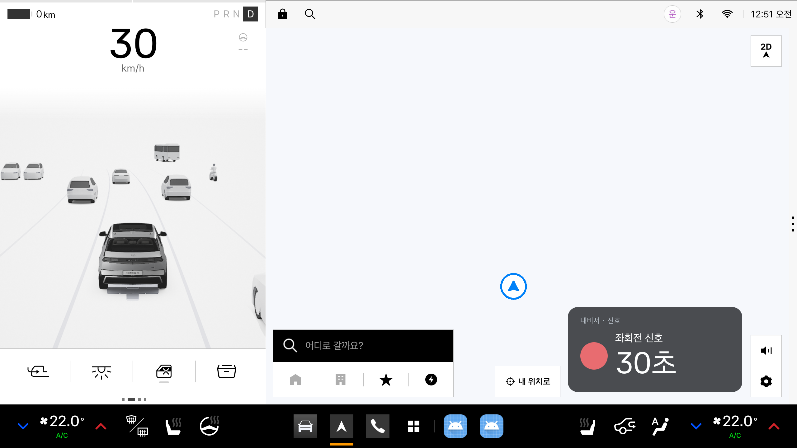
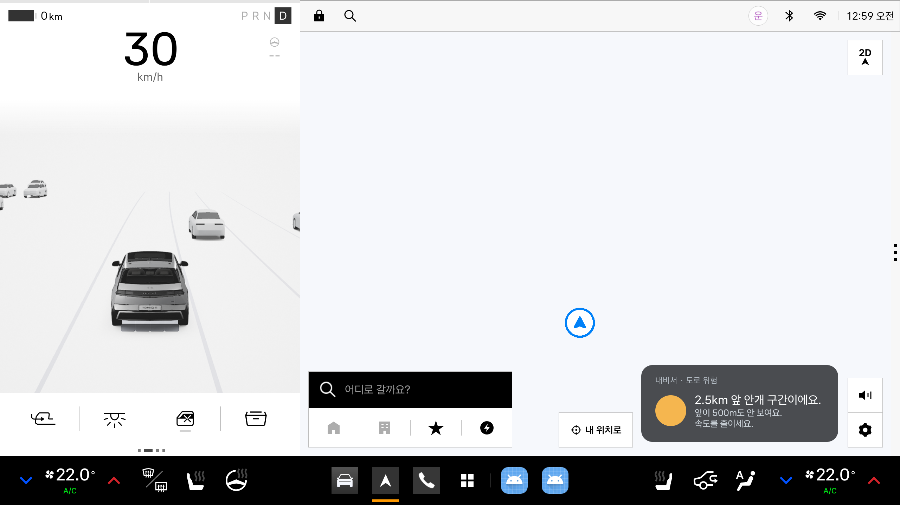
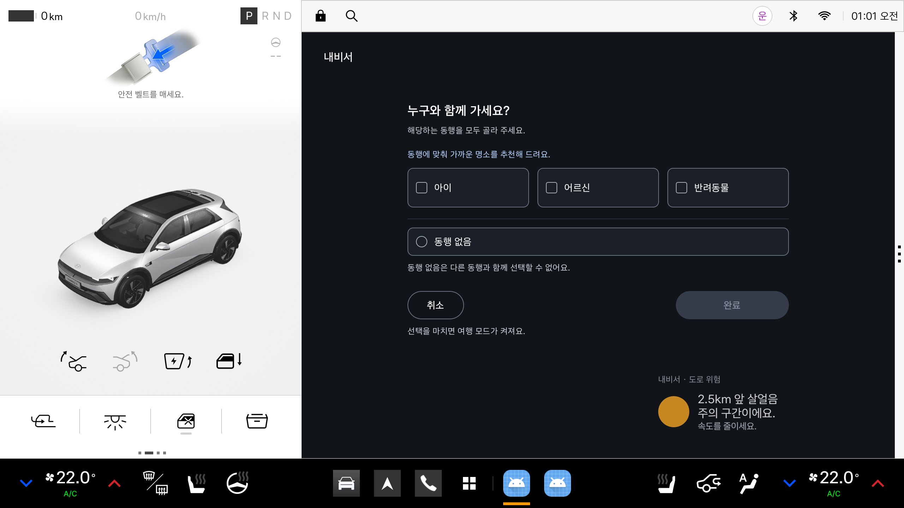
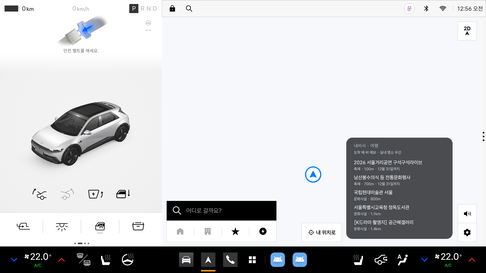
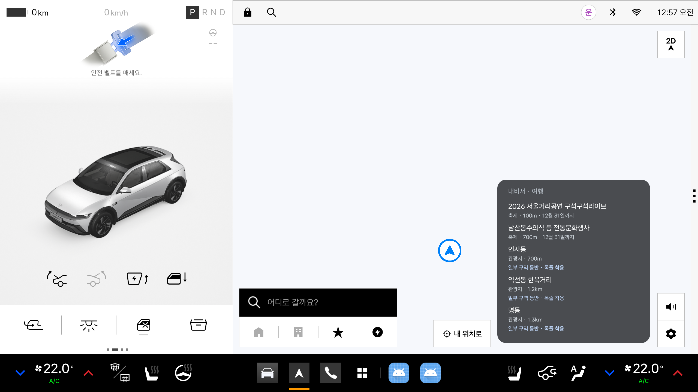
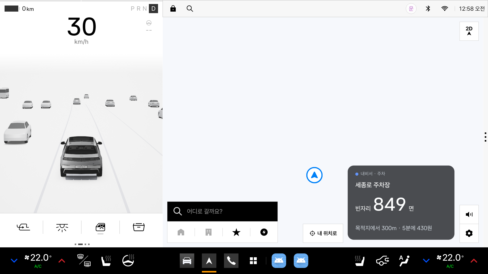

# 내비서

Pleos 내비 속 비서처럼, 앞길의 신호·도로 위험부터 목적지 주차와 동행에 맞춘 여행 정보까지 묻기 전에 카드 한 장과 음성 한 번으로 알려 주는 차량용 안내 앱입니다.

현대자동차그룹 차량용 앱 개발 공모전 개인 참가 출품작입니다. Pleos 내비에 들어갈 기능을 제안하고, 그 모습을 내비 위에 뜨는 안내 카드로 구현한 시제품입니다.

## 무엇을 알려 주나

| 언제 | 안내 |
|---|---|
| 달리는 중 | 갈 방향 신호의 남은 시간, 앞길의 안개·공사·살얼음 |
| 여행 모드에서 목적지를 정할 때 | 목적지 5 km 안 행사 최대 2개, 3 km 안 명소 최대 3개. 명소는 동행(아이·어르신·반려동물)과 도착 때 날씨에 맞춰 고릅니다. (음성 1회, 정차(P) 중 목록 카드) |
| 여행 모드에서 목적지 1 km 또는 3분 앞 | 목적지 500 m 안 주차장 한 곳의 이름·거리·기본요금. 서울 시영주차장 두 곳은 빈자리 수도 알려 줍니다. |

여행 모드는 처음에 꺼져 있고, 꺼져 있으면 신호와 도로 위험만 안내합니다.

카드는 내비 화면 오른쪽 아래, 주소 칩과 내비 버튼 열 사이에 반투명으로 뜹니다. 터치를 받지 않으므로 카드 아래 내비 조작을 가리지 않습니다. 안내할 것이 없으면 카드를 띄우지 않습니다.

## APK와 실행 방법

제출용 release APK: [apk/SUDL_내비서_release.apk](apk/SUDL_내비서_release.apk)

Pleos Connect 에뮬레이터를 실행하고 저장소 루트의 PowerShell에서 설치합니다. 아래 명령은 검증한 기기 `emulator-5556`, 운전자 사용자 `10`을 기준으로 합니다. 다른 환경에서는 `adb devices`와 `adb shell am get-current-user`로 확인한 값으로 바꿉니다.

```powershell
adb -s emulator-5556 install -r --user 10 ".\apk\SUDL_내비서_release.apk"
adb -s emulator-5556 shell am start --user 10 -n com.roadahead/.MainActivity
```

기존 debug APK가 있으면 서명이 달라 덮어쓸 수 없습니다. 이 경우 `adb -s emulator-5556 uninstall com.roadahead`로 기존 앱을 제거한 뒤 설치합니다. 제거하면 기존 앱 설정도 지워집니다.

### 처음 실행할 때

1. 위치 권한 창에서 **앱 사용 중에만 허용**을 선택하고 정확한 위치를 허용합니다. 앱은 차량 속도 읽기 권한도 쓰며, 검증 환경에서는 차량 속도 권한 창이 따로 뜨지 않았습니다.
2. **다른 앱 위에 표시**를 켭니다. Pleos 설정 → 앱 → 앱 목록 → **내비서** → **다른 앱 위에 표시**. 앱 화면의 **앱 정보 열기** 버튼으로도 열 수 있지만, 설정 앱이 이미 열려 있으면 이전 화면만 나올 수 있어 목록으로 들어가는 쪽이 확실합니다. Pleos에는 Android 표준 권한 화면(`ACTION_MANAGE_OVERLAY_PERMISSION`)이 없습니다.
3. 앱으로 돌아오면 기어 **P**에서 공공 데이터는 참고용이며 실제 신호와 도로 상황을 먼저 확인해야 한다는 안내가 뜹니다. 읽고 **확인**을 누릅니다.
4. 안내가 시작되고 알림에 "내비서가 켜져 있어요"가 표시됩니다. 이제 내비로 이동하면 카드가 내비 위에 뜹니다. 안내를 끄려면 알림의 **끄기**를 누릅니다.

기본 모드는 **실시간**, 방향 해석은 **진입 방향**, 여행 모드는 **꺼짐**입니다. 설정은 P에서만 열리며 주행 중에는 설정 버튼이 숨겨집니다.

### 여행 모드

1. P에서 앱의 **설정**을 열고 **여행 모드** 스위치를 켭니다. 동행 선택 화면이 뜨고 앱이 "누구와 함께 가세요? 화면에서 골라 주세요."라고 한 번 묻습니다.
2. **아이·어르신·반려동물** 중 함께 가는 동행을 모두 고르거나 **동행 없음**을 고른 뒤 **완료**를 누릅니다. 완료해야 여행 모드가 켜집니다. 취소하거나 P를 벗어나면 꺼진 채로 둡니다.
3. 답은 기억해 두었다가 다음에 켤 때 미리 골라 둡니다. 여행 모드가 켜져 있으면 설정의 **동행 → 바꾸기**로 바꿀 수 있습니다.

실제 제품에서는 음성으로 답하는 것을 생각하고 있습니다. 에뮬레이터에 마이크가 없어 Pleos 음성 인식을 검증할 수 없으므로, 시제품은 음성으로 묻고 화면 버튼으로 답을 받습니다.

그 뒤 내비에서 목적지를 정하면(말하거나 검색해서 고르면) 경로 안내가 시작된 뒤 목적지 근처 행사·명소를 한 번 말해 줍니다. 목록 카드는 정차(P) 중에만, 최대 1분 동안 보이고 출발하면 닫힙니다. 행사는 도착 예정일에 열리는 것만 동행과 관계없이 고릅니다. 명소는 동행에 따라 아래처럼 고르고, 맞는 이유를 카드에 최대 2개 적습니다.

| 동행 | 명소 고르는 법 | 카드의 이유 예 |
|---|---|---|
| 동행 없음 | 가까운 순 | 없음 |
| 아이 | 유모차 대여·수유실·유아용 의자가 있는 곳 먼저 | 유모차 대여, 수유실 |
| 어르신 | 턱 없는 입구·휠체어 대여·엘리베이터·장애인 화장실이 있는 곳 먼저 | 턱 없는 입구, 엘리베이터 |
| 반려동물 | 반려동물 동반이 확인된 곳만. 확인된 곳이 없으면 명소를 말하지 않습니다. | 일부 구역 동반 · 목줄 착용 |

도착 예정 시각의 목적지 예보에 비·눈·소나기가 있거나, 강수확률이 60% 이상이거나, 기온이 33도 이상 또는 영하 5도 이하이면 실내 명소(박물관·미술관 등)를 앞에 둡니다. 이때 음성으로 "도착할 때쯤 비 예보가 있어 실내 명소를 먼저 골랐어요."라고 말하고 카드에 "도착 때 비 예보 · 실내 명소 우선"을 적습니다. 동행 조건이 먼저이고, 그 안에서 날씨로 순서를 바꿉니다.

목적지까지 1 km 또는 3분 남으면 목적지 500 m 안 주차장 한 곳의 이름·거리·기본요금을 한 번 말하고 카드로 보여 줍니다. 서울 시영주차장 **세종로·동국제강** 두 곳은 10분 안에 갱신된 빈자리 수가 있으면 "빈자리 849면"처럼 함께 알려 주고, 운영 시간 밖이면 고르지 않습니다.

### 시연 모드

가상 콘솔에서 기어를 **P**, 속도를 **0 km/h**로 둔 뒤 앱의 **설정 → 시연 A·B·C·E → 닫기**를 선택하고 내비로 이동합니다. 선택하는 즉시 해당 장면이 시작되며 release APK에서는 안내 음성이 재생됩니다. 장면을 다시 시작하려면 다른 모드로 바꿨다가 해당 장면을 다시 선택합니다.

| 장면 | 확인할 내용 |
|---|---|
| 시연 A | 좌회전 빨간불에 접근해 정차한 뒤, 남은 시간과 좌회전 신호 전환 임박 안내를 확인합니다. |
| 시연 B | 남은 시간을 알 수 없는 직진 빨간불에서 색상 안내를 확인합니다. |
| 시연 C | 안개 → 공사 → 살얼음 순서로 도로 위험 안내를 확인합니다. **살얼음은 합성 자료**입니다. |
| 시연 E | 여행 모드 장면입니다(약 1분). P에서 세종문화회관이 목적지로 정해지면 저장된 동행에 맞춘 행사·명소를 한 번 말하고 목록 카드를 보여 줍니다. 기록된 비 예보 때문에 동행 없음이면 실내 명소가 앞에 옵니다. 이어 출발하고 목적지 1 km 앞에서 세종로 주차장의 빈자리(849면)와 요금을 안내합니다. 여행 모드 설정과 관계없이 켜집니다. |

시연 E는 동행을 묻지 않고 저장된 답을 씁니다. 다른 동행 조합을 보려면 먼저 위의 여행 모드 절차로 동행을 고르고 완료한 뒤 시연 E를 선택합니다. 아직 고른 적이 없으면 동행 없음으로 재생합니다.

시연 A·B의 신호와 C의 안개·공사는 2026-10-28에, E의 관광·날씨·서울 주차 정보는 2026-10-29에 기록한 실제 응답으로, 현재 도로·행사 상황을 뜻하지 않습니다. 날씨와 빈자리는 재생 시각에 맞춰 옮기므로 언제 재생해도 같은 결과가 나옵니다. 행사 날짜는 기록 그대로라 재생하는 날 이미 끝난 행사는 빠지며, 2026-12-31 뒤에는 행사 안내가 나오지 않습니다. 시연은 외부 API를 호출하지 않습니다. 실시간 모드로 돌아가려면 P에서 **설정 → 실시간 → 닫기**를 선택합니다.

### 실시간 데이터 범위

- 신호: **울산** 지역의 공공 신호 데이터입니다.
- 기상: **고속도로 045**의 도로 위험 기상 데이터입니다.
- ITS 돌발·재난: **전국** 데이터에서 현재 위치 주변을 조회합니다.
- 주차: 한국교통안전공단 주차정보 중 이름·좌표·숫자 기본요금이 모두 있는 **전국 10,792곳**을 앱에 넣어 두었습니다(2026-10-29 기준). 빈자리 수는 서울 열린데이터광장 시영주차장 실시간 정보 중 위치를 확인해 연결한 **세종로·동국제강 2곳**만 말합니다. 조회에 실패하거나 근처에 없으면 "주차장 없음"이라고 하지 않고 아무것도 말하지 않습니다.
- 여행: 한국관광공사 관광정보(TourAPI)·반려동물 동반여행·무장애 여행 정보 **전국** 데이터에서 목적지 주변 명소, 도착일의 행사, 반려동물 동반 범위와 편의시설을 조회합니다.
- 날씨 예보: 기상청 단기예보 **전국** 데이터에서 목적지의 도착 시각 예보를 조회해 여행 추천에만 씁니다.

인터넷과 해당 지역의 위치·차량 입력이 필요합니다. 기본 에뮬레이터 GPS 위치에서는 신호나 위험이 표시되지 않을 수 있습니다. 주차와 여행 안내는 내비의 목적지 정보로 동작하므로 GPS 위치와 관계없이 목적지만 정하면 됩니다.

## 테스트 환경과 필요한 설정

| 항목 | 검증 환경 |
|---|---|
| 개발 환경 | Windows 11, PowerShell, Kotlin, JDK 17, Gradle Wrapper 8.10.2 |
| Android 빌드 | compile/target API 35, min API 28, SDK Build Tools 35.0.0 |
| 에뮬레이터 | Pleos Connect v2.1.0, AVD `Pleos_Connect_2_1_API_34`, Android API **34**, `emulator-5556`, 내비 3.3.2-rc5-hotfix.3 |
| AVD 설정 | Cold boot, RAM 4 GB, GPU host, 2560×1440, 시간대 Asia/Seoul |
| 가상 콘솔 | `http://127.0.0.1:8088/`, 설정·시연 진입 시 기어 P / 속도 0 km/h |

가상 콘솔은 아래 포워딩 후 PC 브라우저에서 엽니다. 실시간 주행 시험에서는 콘솔의 기어·속도와 에뮬레이터 GPS 위치를 시험 경로에 맞게 설정합니다. 시연 모드는 기록된 입력을 재생하므로 차량을 움직일 필요가 없습니다.

```powershell
adb -s emulator-5556 forward tcp:8088 tcp:8088
```

에뮬레이터의 내비 지도는 도로·건물이 없는 빈 지도(`connect_empty` 스타일)이고 내비의 자기 차 위치는 움직이지 않습니다. 앱 문제가 아니라 에뮬레이터 내비의 상태이며, 카드는 그 위에 정상으로 표시됩니다.

Pleos 시스템 이미지와 SDK 설치·환경 설정은 [docs/PLEOS_SDK.md 8절](docs/PLEOS_SDK.md#8-windows-에뮬레이터-준비-절차)을 참고합니다. 실차와 API 28 기기에서는 검증하지 않았습니다.

### 소스 빌드와 API 키

JDK **17**과 Android SDK를 설치하고 `JAVA_HOME`, `ANDROID_HOME`을 설정합니다. API 키는 저장소 루트의 gitignore 대상 `api` 파일에 아래 줄 형식으로 입력합니다. 아래는 형식만 나타내며 `=` 뒤에 각 서비스에서 발급받은 값을 넣습니다. `신호등` 키는 공공데이터포털 키로, 신호·관광 정보(국문·반려동물 동반여행·무장애 여행)·기상청 단기예보 조회에 함께 쓰므로 각 서비스의 활용신청이 필요합니다. `서울` 키는 서울 열린데이터광장 키로, 시영주차장 빈자리 조회에 씁니다.

```text
신호등=
재난=
기상=
서울=
```

또는 환경변수 `ROAD_AHEAD_SIGNAL_KEY`, `ROAD_AHEAD_DISASTER_KEY`, `ROAD_AHEAD_WEATHER_KEY`, `ROAD_AHEAD_SEOUL_KEY`를 설정합니다. 환경변수가 `api` 파일보다 우선합니다. 키가 없어도 빌드와 시연 모드는 사용할 수 있고, 해당 키가 필요한 실시간 조회는 동작하지 않습니다. 주차장 목록은 앱에 들어 있어 키가 필요 없습니다. 서울 주차 API는 `http`만 지원해서, 앱의 네트워크 보안 설정에서 `openapi.seoul.go.kr`만 평문 통신을 허용합니다. 제출용 APK에는 실시간 모드용 키가 포함되어 있습니다.

```powershell
.\gradlew.bat :app:assembleDebug :app:testDebugUnitTest :core:test
```

### release 서명과 빌드

키스토어는 저장소 밖에 보관하고, 루트의 gitignore 대상 `keystore.properties`에 아래 네 항목을 입력합니다. 아래는 값 없는 형식입니다. `storeFile`에는 키스토어의 절대 경로를 `/` 구분자로 적습니다.

```properties
storeFile=
storePassword=
keyAlias=
keyPassword=
```

```powershell
.\gradlew.bat :app:assembleRelease :app:testDebugUnitTest :core:test
```

`keystore.properties`가 있으면 `app/build/outputs/apk/release/app-release.apk`에 서명된 APK가 생성됩니다. 이 파일이 없으면 빌드는 성공하지만 결과는 설치할 수 없는 `app-release-unsigned.apk`입니다. 제출용 파일은 서명된 결과를 `apk/SUDL_내비서_release.apk`로 복사한 것입니다. release에서는 코드 축소를 사용하지 않습니다. 서명 설정과 검증 방법은 [Android 앱 서명 문서](https://developer.android.com/studio/publish/app-signing)와 [apksigner 문서](https://developer.android.com/tools/apksigner)를 참고합니다.

## 화면

에뮬레이터 내비의 빈 지도 위에 뜬 실제 카드입니다.












