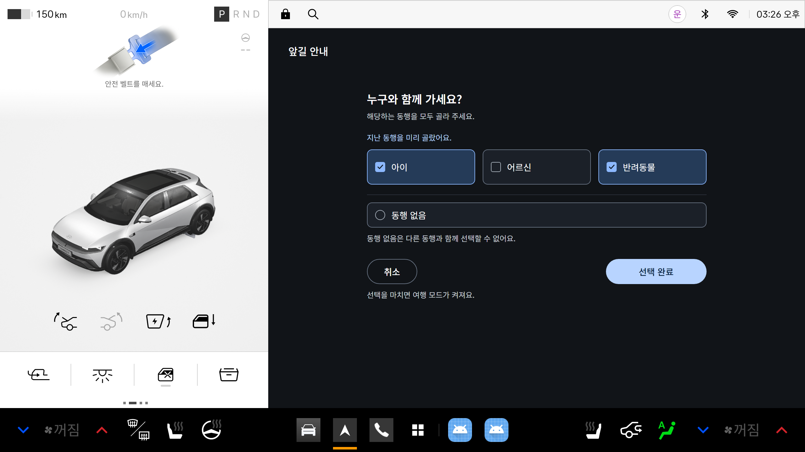
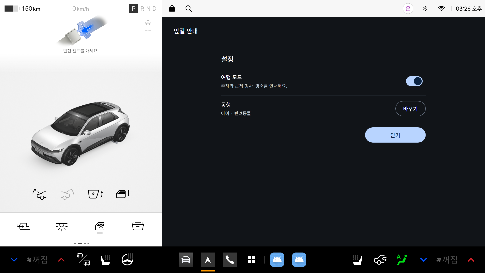
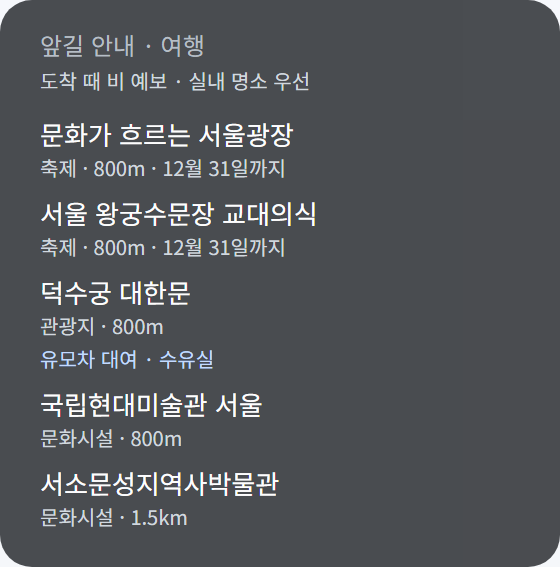
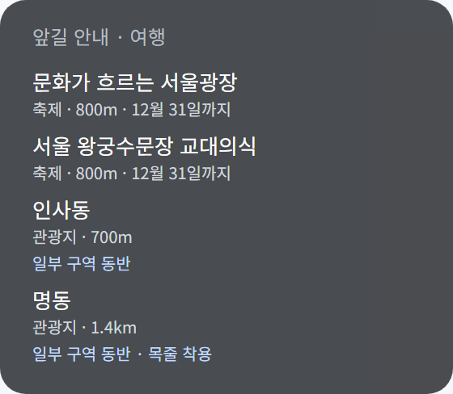
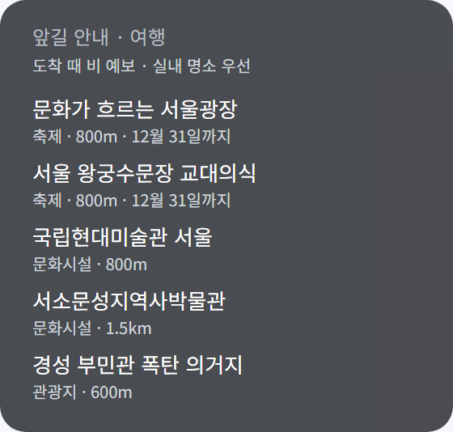
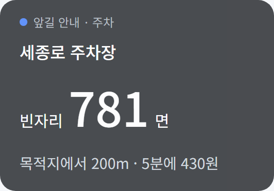
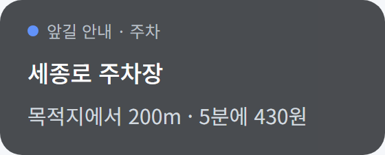

# 여행 모드 화면 디자인 추천안 — T-32

**추천은 ‘동행은 정차 중 한 번 확인하고, 카드에는 장소와 확인된 이유만 남긴다’이다.** 동행 선택은 넓은 체크 버튼, 여행 목록은 필요한 항목에만 이유 한 줄, 주차는 빈자리 숫자를 중심으로 구성한다. 이 문서는 검토할 디자인 안이며 앱 구현 완료 보고가 아니다.

[동작하는 HTML 목업](travel-mode-ui.html) · [치수 측정](mockup-measurements.json) · [목업 데이터·거리 근거](mockup-data.json) · [렌더 스크립트](render_travel_mode.py)

추가 지시와 DESIGN `0a4be62`를 반영했다. 목적지 예시는 **세종문화회관 인근 목업점(37.5725, 126.9760)**으로 맞췄다. 건물 출입구를 검증한 좌표는 아니며 후속 시연의 정확한 목적지는 구현자가 정한다. 이 점에서 세종로 주차장의 TS 좌표까지 직선 **227.15m**로 500m 안이다. 거리 표시는 현재 `koDistance()`와 같은 100m 반올림으로 **200m**다. 장소 좌표는 기존 관광 응답, 주차 값은 T-26 기록에서 가져와 [작은 근거 JSON](mockup-data.json)에 남겼다. 앱·에뮬레이터를 움직여 새로 측정하지 않았다.

## 공통 기준

- 2560×1440, 160dpi, 글자 배율 1.0. 목업의 1 CSS px을 1dp, 글자 1px을 1sp로 맞췄다. 목업 글꼴은 Windows의 **Noto Sans KR**, 앱 구현은 현재 Android 시스템 한글 글꼴을 쓴다. 새 글꼴 자산을 넣자는 제안은 아니다.
- 카드 폭 **560dp**, 안쪽 폭 **480dp**, 패딩 좌우 **40dp**, 위 **28dp**, 아래 **36dp**, 모서리 **32dp**, 창 전체 alpha **0.8**, 터치 없음. `BOTTOM|END`, x=176dp, y=40dp를 유지한다.
- 기존 [시연 E](../demo/overlay-e-travel.png)의 차량·내비 화면 위에 HTML을 합성했다. 현재 캡처의 하단 시스템 영역 140px를 고려하면 카드 우하단은 **(2384, 1260)**, 왼쪽은 **1824px**다. 앱에서는 `bottom=180`을 새로 하드코딩하지 않고 기존 WindowManager 인셋·앵커를 유지한다.
- 설정/동행 화면은 `MainActivity` 안의 불투명 Material3 dark 화면이다. 목업에서 차량 패널 오른쪽 앱 영역은 (853,90)부터 1707×1210px다. 구현은 실제 Activity 가용 영역에 맞추며 이 화면 좌표를 하드코딩하지 않는다.
- 글자 굵기는 질문·설정 제목 600, 완료·취소·바꾸기 버튼·설정 항목명·주차 제목·빈자리 숫자 500, 동행 선택 버튼·여행 항목과 나머지 정보 400이다. 검증에 쓴 로컬 글꼴 경로는 `C:/Windows/Fonts/NotoSansKR-VF.ttf`다.

| 역할 | 색 |
|---|---|
| 앱 배경 / 카드 배경 | `#111418` / 기존 `#F0111418` |
| 주 정보 / 보조 정보 | `#FFFFFF` / `#C9D1D9` |
| 선택·동행 이유 / 선택 배경 | `#B8D4FF` / `#253B58` |
| 선택 테두리 / 기본 테두리 | `#8CB8FF` / `#687383` |
| 카드 머리줄 / 주차 분류 점 | 기존 `#A7B0BA` / 기존 `#3E7BFA` |

선택은 색뿐 아니라 체크·라디오 모양으로 구별한다. 새 터치 목표는 높이 **80dp 이상**으로 잡았다. 프로젝트의 64dp 최소값을 넘고, [Android for Cars의 76×76dp 가이드](https://developers.google.com/cars/design/automotive-os/design-system/sizing)도 참고했다. 이는 Pleos 인증이나 실차 사용성 검증을 마쳤다는 뜻은 아니다.

## 1. 동행 선택 화면

### 추천 배치와 문구

작은 팝업 대신 **설정에서 이어지는 전용 화면**을 쓴다. 질문, 선택, 완료를 한 화면에서 읽게 하며 스크롤은 요구하지 않는다.

| 요소 | 규격·문구 |
|---|---|
| 내용 폭 | **1080dp**, 앱 가용 영역 가로 가운데 정렬 |
| 질문 | **36sp / 행높이 52dp**, `누구와 함께 가세요?` |
| 설명 | **24sp / 36dp**, `해당하는 동행을 모두 골라 주세요.` |
| 지난 답 표시 | **24sp / 36dp**, 파랑 보조색, `지난 동행을 미리 골랐어요.`. 첫 사용에서는 `동행에 맞춰 가까운 명소를 추천해 드려요.` |
| 첫 줄 | 왼쪽부터 **아이 / 어르신 / 반려동물**. 각각 **344×112dp**, 사이 **24dp**, 둥근 모서리 **16dp** |
| 선택 표시 | 왼쪽 **32dp 사각 체크**, 텍스트 **28sp / 40dp**. 전체 버튼이 터치 목표이며 선택 시 테두리 2dp·선택 배경·체크를 함께 표시 |
| 동행 없음 | 구분선과 위 간격 뒤 **1080×80dp**, **32dp 원형 라디오**. 첫 줄의 체크 선택과 시각적으로 구분 |
| 단독 선택 설명 | **24sp / 36dp**, `동행 없음은 다른 동행과 함께 선택할 수 없어요.` |
| 하단 | 왼쪽 **취소 160×80dp**, 오른쪽 **선택 완료 320×80dp**, 글자 **28sp**. 내용과 48dp 간격 |
| 완료 안내 | 켜기 진입에서는 `선택을 마치면 여행 모드가 켜져요.`. 수정 진입에서는 `완료하면 동행 선택을 기억해요.` |

### 선택·저장 규칙

- 아이·어르신·반려동물은 독립 체크로 여러 개를 고른다. 마지막 체크를 끄면 **미선택** 상태가 되고 완료는 비활성이다. 미선택을 동행 없음으로 자동 변환하지 않는다.
- **동행 없음**을 누르면 세 체크를 모두 해제하고 원형 표시 하나만 선택한다. 이미 선택된 동행 없음을 다시 누르면 그대로 둔다. 다른 동행을 누르면 동행 없음이 해제된다.
- **첫 사용은 미선택**이다. 임의의 동행을 정하지 않는다. [첫 사용 목업](companion-first.png), [동행 없음 목업](companion-none.png)을 함께 제공한다.
- 지난 답은 **완료한 답만** 기억한다. 선택 화면을 열 때 지난 답을 복사해 임시 선택으로 보여 주며, 저장 내용과 임시 선택을 분리한다.
- 여행 모드 OFF에서 스위치를 누르면 이 화면을 열고 정확히 한 번 `누구와 함께 가세요? 화면에서 골라 주세요.`를 음성으로 묻는다. 음성이 없어도 같은 질문이 화면에 있으므로 버튼으로 끝낼 수 있다. 재구성·회전마다 다시 묻지 않는다. 이 목업에서는 음성을 재생하지 않는다.
- **선택 완료를 누르는 시점에 동행 저장과 여행 모드 ON을 함께 확정**하는 안을 추천한다. 지난 답이 있어도 매번 확인한다. 활성화 중 취소·뒤로가기는 OFF를 유지하고 지난 답을 바꾸지 않는다.
- 이미 ON인 상태에서 동행을 바꾸는 중 취소하면 모드와 지난 답을 유지한다. `바꾸기` 진입에는 불필요한 재질문 음성을 붙이지 않는다.

**설계와 다른 제안:** 작업 중 갱신된 DESIGN 10.1은 완료 전 P 이탈에도 모드를 ON으로 두고 지난 답(첫 사용은 동행 없음)을 쓰도록 정했다. 본안은 **선택 완료 때 활성화 확정**을 추천한다. 첫 사용의 미응답을 동행 없음으로 저장한 답처럼 취급하지 않고, 취소 전후 상태를 분명히 하려는 이유다. Claude가 이 차이를 검토한 뒤 DESIGN에 반영할지 결정해야 하며 이 문서가 기존 설계를 몰래 변경한 것은 아니다.

### 설정에서 다시 찾는 방법

기존 설정의 **모드 다음, 방향 해석 앞**에 여행 모드 구간을 둔다. 위 이미지는 이 구간만 보여 주는 목업이다.

스위치 행 아래에 **동행**을 28sp, `아이 · 어르신 · 반려동물` 같은 현재 선택을 24sp로 보여 주고 오른쪽 **바꾸기 160×80dp**를 둔다. 순서는 항상 아이→어르신→반려동물이다. OFF이면 `지난 동행`과 기억한 답을 보여 주고 바꾸기 버튼은 숨긴다. OFF에서 다시 켜면 확인 화면에서 바로 바꿀 수 있다. 스위치를 끌 때 저장한 답은 지우지 않는다. **OFF 확정 때 주차·여행 카드와 그 예약 안내는 닫고 신호·도로 위험 안내만 남긴다.**

### P를 벗어나면

| 상황 | 즉시 보일 화면 | 모드·저장 답 | 다시 P가 되면 |
|---|---|---|---|
| OFF→켜기 확인 중 D 또는 P 외 상태 | 선택·설정을 닫고 기존 기본 Activity 화면으로 복귀 | OFF, 지난 답 유지, 임시 답 폐기 | 자동으로 다시 열거나 음성 질문하지 않음 |
| 이미 ON에서 동행 수정 중 D 또는 P 외 상태 | 동일 | ON, 지난 답 유지, 임시 답 폐기 | 설정의 바꾸기로 다시 진입 |
| 선택 완료와 기어 변경이 겹침 | 완료 처리 시점에 P인지 다시 확인 | P가 아니면 저장하지 않음 | 위 취소와 동일 |

진행 중인 **동행 질문의 발화만** 닫힘과 함께 취소한다. 신호·위험 발화를 함께 중단하지 않는다. 주행 중 새 확인창·토스트·선택 버튼을 띄우지 않는다. 현재 `MainActivity`의 `LaunchedEffect(state.parked)`가 설정을 닫는 흐름을 선택 화면까지 확장하면 된다. 선택 화면은 오버레이로 만들지 않는다.

**근거:** 복수 선택은 사각 체크, 단독 선택은 원형으로 구별해 문장만 읽어야 하는 부담을 줄인다. 완료 전 확정하지 않아 기어 변경으로 화면이 닫혔을 때 보이지 않는 설정 변경을 막는다.

**버린 안:** 작은 중앙 다이얼로그 안에 네 개의 칩을 섞는 안은 단독/복수 규칙과 큰 터치 목표를 동시에 설명하기 어려워 버렸다.

**구현할 파일:** `app/.../MainActivity.kt`(진입·P 해제·확정), `ui/Settings.kt`(현재 답·수정·기억), 새 `ui/CompanionSelection.kt`(이름은 구현 시 결정), `RoadAheadService.kt`(질문 음성 1회·취소·선택 전달), `res/values/strings.xml`.

## 2. 여행 목록 카드의 동행 이유

[전체 2560×1440 목업](travel-child.png) · [반려동물 전체 목업](travel-pet.png)

아래 카드는 **아이만 선택 / 반려동물 선택 / 동행 없음의 독립 예시**다. 앞의 아이+반려동물 선택 화면과 한 사용자의 연속 여정으로 묶은 자료가 아니다. 덕수궁의 반려동물 조건은 주어진 자료에서 확인하지 못했으므로 반려동물 카드에 넣지 않았다.

### 추천 정보 순서

머리줄은 **`내비서 · 여행` 24sp** 그대로 둔다. 동행 이름을 반복하지 않는다. 각 장소는 다음 순서다.

1. **이름 26sp / 행높이 38dp, 흰색**, 기본 한 줄.
2. **종류 · 거리**(행사면 기간 추가) **20sp / 29dp, `#C9D1D9`**.
3. 선택한 동행과 관계있는 **확인된 이유 최대 두 개**, ` · `로 연결, **20sp / 29dp, `#B8D4FF`**, 위 간격 **4dp**, 한 줄.

항목 사이는 기존 **12dp**, 최대 **5개**다. 이유가 없으면 세 번째 줄과 그 간격을 통째로 뺀다. 행사에 동행 이유를 붙이거나 모든 항목에 `정보 없음` 줄을 만들지 않는다. 버튼·배지·이모지·새 아이콘은 넣지 않는다.

목업의 두 행사는 기존 시연 E의 예시이며 새 목적지점에서 모두 반올림 **800m**다. 행사 구간은 날짜·거리 기준을 유지하고, 그 뒤 명소 구간에서 동행 조건에 맞는 곳을 앞세운다. 이 문서에서 행사 개수·기존 검색 반경·새 추천 점수를 재설계하지 않는다. 아이·어르신 관련 정보가 미확인이면 그 혜택을 주장하지 않는다. 반려동물 선택에서는 **동반 가능 범위가 확인되지 않은 명소를 추천에 넣지 않는다**.

### 표준 어휘와 선택 순서

| 확인된 정보 | 카드 문구 | 주의 |
|---|---|---|
| 유모차 대여 가능 | `유모차 대여` | 유모차를 갖고 들어갈 수 있다는 뜻으로 확대하지 않음 |
| 수유실 있음 | `수유실` | 아이 선택일 때 |
| 휠체어 대여 가능 | `휠체어 대여` | 건물 전체가 휠체어로 접근 가능하다는 뜻은 아님 |
| 주출입구 턱 없음 | `턱 없는 입구` | 모든 통로가 무장애라고 바꾸지 않음 |
| 엘리베이터 있음 | `엘리베이터` | 어르신 선택일 때 보조 이유 |
| 장애인 화장실 있음 | `장애인 화장실` | 어르신 선택일 때 보조 이유 |
| 전 구역 동반 가능 | `반려동물 동반` | 구역 제한이 있을 때 이 문구를 쓰지 않음 |
| 일부 구역 동반 가능 | **`일부 구역 동반`** | 제한 표현을 생략하지 않음 |
| 목줄 필수 등 짧은 필수 조건 | 예: `목줄 착용` | 다른 편의 정보보다 먼저 표시 |

이유는 원본 설명을 통째로 붙이지 않고 위 어휘로 정리하되, **긍정적으로 확인한 사실만** 쓴다. 범위·반려동물 종류·필수 조건이 불명확한 설명은 임의로 ‘동반 가능’으로 요약하지 않는다. 길고 중요한 조건을 두 개의 짧은 문구 안에 정확히 담을 수 없으면 그 장소를 반려동물 자동 추천에서 보류한다. 이유를 줄이려고 조건을 삭제하지 않는다.

- **아이만:** 유모차 대여→수유실, 최대 둘.
- **어르신만:** 턱 없는 입구→휠체어 대여→엘리베이터→장애인 화장실 중 앞의 둘.
- **아이+어르신:** 확인된 정보가 양쪽에 있으면 아이 이유 하나→어르신 이유 하나. 한쪽에만 정보가 있으면 그쪽에서 둘까지.
- **반려동물 포함:** 동반 범위를 첫 번째, 짧은 필수 조건이 있으면 두 번째에 우선한다. 필수 조건이 없을 때만 남은 한 자리에 사람 동행 이유를 넣는다. 아이·어르신이 모두 있으면 턱 없는 입구 등 접근 정보를 먼저 고르는 것은 이번 디자인 판단이다. **화면 이유 두 개가 동행 전체의 정렬 근거 전부를 열거한다는 뜻은 아니다.**
- 같은 이유는 반복하지 않는다. 이 순서는 **화면 문구 선택 순서**이며 추천 점수 설계를 대신하지 않는다.

현재 DESIGN 10.2의 이유 순서는 아이→어르신→반려동물이다. 본안의 **반려동물 범위·필수 조건 먼저**는 그 순서와 다른 디자인 제안이다. 두 문구 제한에서 부분 동반이나 목줄 조건이 밀려나지 않게 하려는 판단이며 Claude의 검토가 필요하다.

실제 자료 예는 다음처럼 다룬다.

- 아이의 덕수궁 대한문: `관광지 · 800m` / **`유모차 대여 · 수유실`**. 원래 시청 기준 176m였던 장소를 새 목업점에서 다시 계산했다.
- 어르신의 같은 장소: `관광지 · 800m` / **`턱 없는 입구 · 휠체어 대여`**.
- 반려동물의 명동: `관광지 · 1.4km` / **`일부 구역 동반 · 목줄 착용`**. 전 견종 조건은 특정 견종 제한이 아니므로 별도 세 번째 문구로 늘리지 않는다.
- 반려동물의 인사동: `관광지 · 700m` / **`일부 구역 동반`**. 추가 제한이 없는 것으로 추측하지 않는다. 두 장소의 동반 범위가 같아 새 목적지점에서 더 가까운 인사동을 먼저 둔다.
- **효자스테이는 숙박**이므로 현재 `TourKind`의 관광지·문화시설·레포츠·행사 범위에 넣지 않는다. 반려동물 가능 정보가 있다는 이유만으로 숙박 카테고리를 늘리지 않는다.

### 날씨는 목록 전체의 이유 한 줄로

[동행 없음·비 예보 전체 목업](travel-weather.png). 머리줄 바로 아래에 **`도착 때 비 예보 · 실내 명소 우선`**을 **20sp / 29dp, `#C9D1D9`**로 둔다. 머리줄과 4dp, 다음 항목과 20dp 간격이며 **총 33dp**가 추가된다. 개별 동행 이유의 파랑과 구별하고 날씨 아이콘·별도 카드·온도/확률/발표시각 나열은 넣지 않는다. 문구에 ‘명소’를 넣어 행사를 실내 행사로 골랐다는 오해를 피한다.

- **표시 조건:** DESIGN 10.2의 궂은 도착 예보가 있고, 그 때문에 고른 명소에 실내 분류(문화시설14)가 하나 이상 들어갔을 때만 표시한다. 음성의 날씨 설명과 같은 조건을 기본으로 하되, 높이 조정으로 보이는 항목을 줄인 뒤 실내 명소가 하나도 남지 않으면 카드의 날씨 줄도 뺀다. 이때 항목을 다시 채우며 레이아웃을 반복 변경하지 않는다.
- 궂음 기준은 `PTY != 0`, `POP ≥ 60`, `TMP ≥ 33`, `TMP ≤ −5`다. 표현은 `비 / 비나 눈 / 눈 / 소나기 / 무더위 / 강추위` 중 하나만 고르고 우선순위는 DESIGN의 **PTY→POP→기온**을 따른다. 머리줄은 바꾸지 않고 위 한 줄의 `비` 자리만 바꾼다.
- 예보 실패·도착 시각 무자료·궂지 않음·선택된 실내 명소 없음이면 이 줄과 간격을 통째로 뺀다. 빈자리를 `맑음`이나 `날씨 정보 없음`으로 채우지 않는다.
- 추천 순서는 **동행 조건→실내→거리**다. 아이 카드에서는 확인된 유모차·수유실이 있는 덕수궁이 실내 두 곳보다 먼저다. 반려동물 카드에는 확인된 문화시설14가 없어 날씨 줄을 표시하지 않았다. 비가 온다고 미확인 장소를 반려동물 추천에 추가하지 않는다. 행사는 그대로 앞에 둔다.
- 동행 없음의 비 예보 목업에서는 국립현대미술관 서울(800m), 서소문성지역사박물관(1.5km)을 경성 부민관 폭탄 의거지(600m)보다 먼저 둬 **가깝기만 한 순서와 달라진 이유**를 보인다.
- 실내 두 곳의 동행 편의 정보는 이 목업 자료에서 확인하지 못했으므로 동행 이유를 붙이지 않았다. 정보가 없다는 확정이 아니며 실제 후속 응답에서 확인되면 정렬과 이유를 다시 채운다.
- 시연 기준 예보는 [2026-10-29 17시 발표 기록](../spikes/travel-companion/forecast-20261029-1700.json)의 **20:00, PTY=1, POP=60, TMP=10°C**, 격자60/127이다. 실제 기록을 읽어 확인했으며 새 API를 호출하지 않았다. 재생 시각 이동은 DESIGN 10.4를 따른다. 이 HTML은 예보 재생 엔진이 아니다.

**날씨 표시의 버린 안:** 머리줄에 `여행·아이·반려동물·비`를 모두 붙이는 안은 무엇이 선택 이유이고 무엇이 상태인지 구별하기 어려워 버렸다.

### 줄이 넘칠 때

- 이유 둘의 실제 그리기 폭이 480dp를 넘으면 **낮은 우선순위 이유를 통째로 빼고 하나만** 보여 준다. 어휘 하나를 자르거나 글자를 줄이지 않는다. 범위·필수 조건을 빼야만 들어가는 반려동물 장소는 위 보류 규칙을 적용한다.
- 종류·거리·기간은 기본 한 줄을 유지한다. 긴 기간은 사실을 보존한 짧은 날짜 표기로 바꾸고, 그래도 넘치면 기간만 다음 줄로 보낸다. 날짜를 잘라 표현하지 않는다.
- **고유명사는 말줄임하지 않는다.** 확인된 공식 짧은 이름이 있으면 그것을 쓰고, 없으면 **26sp를 유지하며 자연 줄바꿈**한다. 기본 1줄 규격에 대한 이 예외를 추천한다. 폭 고정·크기 고정·임의 길이의 이름·항상 1줄·정보 손실 없음은 동시에 보장할 수 없다.
- 이름이 늘어나 카드가 **880dp**를 넘으면 끝 항목을 **하나씩 통째로** 빼서 들어가게 한다. 최대 5개이지 항상 5개를 채우는 규칙은 아니다. 항목 내부를 자르거나 스크롤·자동 페이지 넘김을 만들지 않는다. 5개 모두 이름 2줄+보조+이유인 경우 **856dp**다. 여기에 날씨 줄이 있으면 **889dp**여서 마지막 항목을 빼고 4개를 온전히 보여 준다.
- 여행 목록은 P에서만 보이며 P를 벗어나면 닫히는 기존 흐름을 유지한다. 높이 여유를 이유로 D에서 목록을 늘리지 않는다.

**근거:** 종류·거리의 위치를 매번 유지하고 이유만 그 아래에 둬서 시설 설명이 행사 기간이나 거리와 섞이지 않는다. 제한을 먼저 읽히게 해 ‘일부 구역’을 ‘어디든 동반’으로 보이지 않게 한다. 머리줄의 동행 나열은 항목의 사실을 추가하지 않아 생략한다.

**버린 안:** 이유를 보조 줄 끝에 계속 이어 붙이는 안은 종류·거리·기간의 끝을 밀어내므로 버렸다. 화면이 좁다고 20sp 아래로 줄이지 않는다.

**구현할 파일:** `ui/OverlayCard.kt`(이유·날씨 줄·실측 개행·최대 높이), `core/.../model/Models.kt`(장소의 확인된 편의/동반 정보·표시 이유·날씨 맥락), `core/.../advice/TravelAdvisor.kt`(DESIGN에 맞는 선택·표시 이유 전달), `feed/Apis.kt` 및 `RoadAheadService.kt`(조회 결과·도착 예보·선택 전달). API 필드와 정렬 정책은 Claude의 갱신된 DESIGN 10.2를 따른다. 공통 `text()`의 변경으로 신호·위험 카드까지 행수가 바뀌지 않도록 주차·여행에 필요한 개행 규칙만 분리한다.

## 3. 서울 빈자리가 있는 주차 카드

### 현재 코드 확인

`app/src/main/kotlin/com/roadahead/ui/OverlayCard.kt`를 읽었다. DESIGN §10의 **머리줄→이름→빈자리→거리·요금 순서와 파랑 분류는 구현되어 있다.** 다만 모든 줄을 충분히 읽게 하는 배치는 추가 조정이 필요하다.

| 현재 구현 | 코드 근거·해석 |
|---|---|
| 폭·위치·alpha | 25~32행: 560dp, BOTTOM/END, x=176, y=40, alpha=0.8 |
| 패딩 | 51행: 좌우40·위28·아래36. 본문 폭은 480dp |
| 분류와 이름 | 101·104~113·131행: 파랑 `#3E7BFA`, 88dp 원+간격24, 이름 34sp. 이름이 실제로 쓸 수 있는 폭은 **368dp** |
| 빈자리 | 132행: `available != null`일 때만 `빈자리 n면` 전체를 **96sp**, 루트에 표시 |
| 거리·요금 | 133~134행: 30sp, ` · ` 연결, 최대2줄. `목적지에서` 접두사는 여기서 추가하지 않고 모델 문자열을 그대로 사용 |
| 말줄임 | 150~151행: 공통 `text()`가 maxLines와 END ellipsize를 설정. 여행도 현재 같은 규칙 |

동국제강 제목 자체가 지금 잘린다고 단정하지 않는다. 목업 글꼴에서 `동국제강 공영주차장(시)` 34sp는 343.40px로 368px에 들어갔다. 반면 `빈자리 10면` 전체 96sp는 **481.34px**, 새 세종로 예시의 `빈자리 781면`은 **534.62px**로 480px을 넘는다. 이는 **Chromium+Noto Sans KR의 측정**이며 실제 Android 줄바꿈을 시험한 결과는 아니다.

### 추천: 분류 점을 작게, 숫자만 크게

[전체 2560×1440 목업](parking-available.png)

| 순서 | 추천 규격·문구 |
|---|---|
| 머리줄 | **16dp 파란 원** + 간격12 + **24sp / 34dp** `내비서 · 주차`, 색 `#A7B0BA` |
| 제목 | 아래 간격20, **34sp / 48dp**, 흰색, **480dp 전체 폭**. 예: `세종로 주차장` |
| 빈자리 | 제목 아래16. `빈자리` **32sp**, 숫자 **96sp**, `면` **32sp**, 같은 기준선. 요소 간격12. 예: **빈자리 781면**. 숫자 영역 행높이144dp |
| 보조 | 빈자리 아래20. **30sp / 44dp**, `#C9D1D9`, **`목적지에서 200m · 5분에 430원`** |

기존 88dp 원을 머리줄의 16dp 분류 점으로 바꾸는 것은 **이번 디자인의 명시적 변경 제안**이다. 큰 원보다 주차장 이름과 빈자리 숫자가 먼저 읽히게 하고, 제목에 본문 전체 폭을 준다. 신호·위험 카드의 원 크기까지 바꾸자는 제안은 아니다.

세종로는 T-26 마지막 기록에서 **총1,260·점유479·빈자리781면**, 기본 **5분/430원**이었다. 총면수와 점유는 화면에 더하지 않는다. 새 목적지점에서 227.15m를 현재 거리 함수처럼 반올림해 200m로 썼다. 시연의 최종 목적지와 새 기록이 정해지면 데이터만 바꾸고 이 배치는 유지한다.

보조 줄의 이번 실제 예시는 30sp에서 **408.84px**로 한 줄에 들어가므로 나누지 않는다. 긴 거리·요금 조합만 ` · ` 위치에서 두 줄로 나누고 줄바꿈 뒤의 점은 뺀다. 요금이 모르면 요금과 점을 함께 생략하고, 거리는 목적지 기준임을 남긴다. 제목도 검증한 짧은 이름 우선, 부족하면 34sp로 자연 개행한다.

숫자는 **0~99,999까지 96sp**로 표시할 수 있는 공간을 확보한다. 더 긴 숫자로 한 줄 폭이 넘으면 `빈자리` 라벨을 윗줄로 보내고 숫자·단위는 다음 줄에 온전히 쓴다. 그 줄도 넘을 때만 숫자를 80sp→72sp 순으로 맞춘다. 뜻을 바꾸는 `999+`, `많음`으로 바꾸지 않는다. 72sp에서도 폭이 넘치는 모델 값은 데이터 검증 대상이며 정상 주차면수로 표시하지 않는다.

### 빈자리를 모를 때

[전체 2560×1440 목업](parking-unknown.png)

머리줄과 이름 다음에 **거리·요금만** 온다. 빈자리 줄·여백·대시·0·`확인 중`·오래된 숫자를 넣지 않는다. 카드 높이가 줄어들고 우하단 기준점은 그대로다. 현재 목업 높이는 **빈자리 있음 390dp / 모름 226dp**다.

빈자리 숫자는 [T-26 파서 계약](../spikes/seoul-parking.md)에 따라 서울 연계·갱신 시각 10분 이내·정상 면수일 때만 온다는 전제다. **점유 차량 수를 그대로 ‘빈자리’로 쓰면 안 된다.** unknown과 실제 숫자 0은 다르며, 모델에 유효한 0이 온 경우에는 0으로 그릴 수 있다. 다만 어떤 주차장을 선택할지는 후속 주차 판단 로직의 일이다. 시설 수·점유 수·API 출처·갱신 초 단위 숫자는 이 작은 카드에 더하지 않는다. 주차 카드는 동행에 따라 모양이나 순서를 바꾸지 않는다.

**근거:** 숫자만 크게 두면 ‘빈자리 781면’을 한 덩어리로 읽으면서도 긴 전체 문장을 96sp로 넣는 폭 문제를 피한다. 모를 때 숫자를 생략하면 무자료를 만차로 오해할 여지를 줄인다.

**버린 안:** 파란 원 안에 P나 빈자리 숫자를 넣는 안은 숫자 공간을 원의 지름으로 제한하고 텍스트의 읽기 순서를 나눠 버려 선택하지 않았다.

**구현할 파일:** `ui/OverlayCard.kt`(주차 전용 머리줄·숫자 기준선·개행), `core/.../advice/ParkingAdvisor.kt`와 표시 모델(목적지 기준 거리 문구 확인), `feed/Apis.kt` 및 `RoadAheadService.kt`(T-30 서울 빈자리 입력). 서울 매칭·신선도 구현은 T-30에서 하며 이 작업에서는 앱 파일을 수정하지 않았다.

## 목업 검증과 인계

`py -3.12 docs/design/render_travel_mode.py`로 **전체 화면 9장과 카드 상세 5장**을 생성했다. Python Playwright/Chromium은 이 PC에 설치되어 있던 것을 썼고 패키지·브라우저를 새로 설치하지 않았다. 배경은 기존 시연 캡처이며, 행사 날짜·거리와 동행 시설·서울 빈자리는 **기록을 사용한 디자인 예시**다. 실시간 호출 결과 화면이 아니다. 화면에서 음성을 재생하지 않는다.

- 9장 모두 **2560×1440 / deviceScaleFactor=1**, 카드 5상태는 모두 **x=1824, 폭560, 아래끝1260**이다.
- [측정 JSON](mockup-measurements.json)에 각 글줄의 fontSize·실제 폭/높이, 버튼 크기와 카드 사각형을 남겼다. 이 예시들에서 넘침·잘림은 없었고 모든 새 터치 목표는 **80dp 이상**이었다.
- 첫 사용 완료 비활성, 체크 복수 선택, 동행 없음의 배타 선택, 다른 동행 선택 시 없음 해제, 완료 저장, 활성화 중 P 이탈의 저장 취소, ON에서 수정 중 P 이탈의 기존 답 유지를 HTML 목업에서 확인했다. HTML의 지난 답은 고정 초기값이며 저장 확인은 세션 메모리 범위다. 실제 앱의 영속 저장·기어 이벤트·TTS 취소를 검증한 것은 아니다.
- 밝은 배경 `#F5F7FA` 위 기존 alpha를 합성해 계산한 대비는 흰색 **8.50:1**, 보조색 **6.03:1**, 이유색 **6.12:1**, 머리줄 **4.60:1**이었다. [W3C의 대비 설명](https://www.w3.org/WAI/WCAG21/Understanding/contrast-minimum)에 따른 계산 참고값이며 다른 지도 배경이나 Android 렌더링까지 인증한 결과는 아니다.

Claude에게 요청할 디자인 판단은 **① 동행 완료 때 모드 활성화를 확정하는 흐름, ② 긴 이름의 자연 개행 예외, ③ 주차의 16dp 분류 점, ④ 부분 동반·필수 조건을 먼저 읽히게 하는 이유 순서**다. 날씨는 **조건을 만족할 때만 보이는 목록 전체 맥락 한 줄**로 추천한다. 모두 이 문서의 추천안 한 세트이며 승인 전 앱에 반영하지 않았다. 실제 구현 때 같은 예시로 Android의 글자·인셋을 다시 확인한다.
